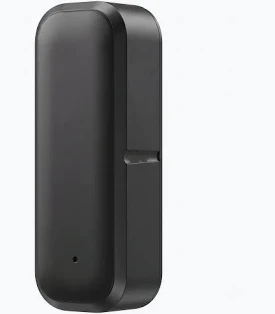
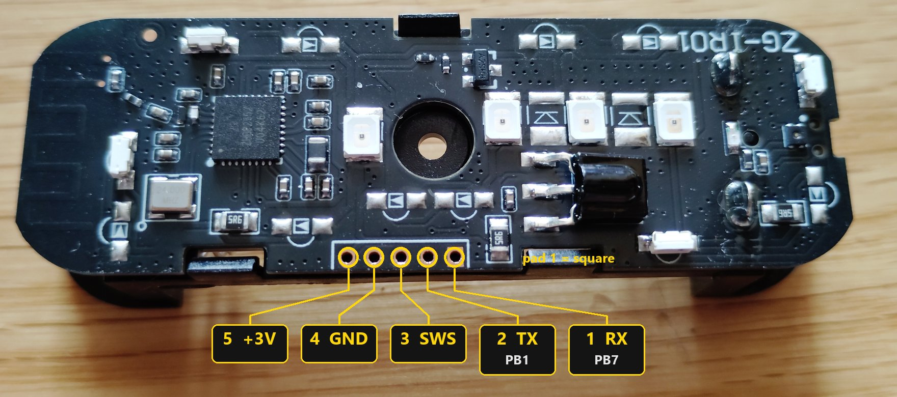

# HOBEIAN ZG-IR01 battery IR blaster



Board `BOARD_ZG_IR01` (fork-local, not in upstream ZigbeeTLc): a battery Zigbee
IR blaster with a temperature / humidity sensor, sold as `_TZE200_33rdmvgw` /
`ZG-IR01`. With this firmware it joins as `HOBEIAN` / `ZG-IR01-z`.

The point of the firmware is IR codes of any protocol and any practical length.
The stock firmware decodes and validates each frame and moves codes to the hub
in chunks, so long codes (a Mitsubishi mini-split sends a 144-bit frame twice,
about 580 timings) could not be learned or sent.

## Hardware

TLSR8258 (marked `Z2`), 1M flash, 2 x AAA. Pin map in
[src/board_zg_ir01.h](../src/board_zg_ir01.h). Test pads, counting from the square
one: 1 = PB7 (UART RX), 2 = PB1 (UART TX), 3 = SWS, 4 = GND, 5 = +3V. The stock
firmware uses the UART at 115200; this firmware does not use it.



To flash, connect a Telink SWire programmer to pads 3 (SWS), 4 (GND) and
5 (+3V), with the batteries out. For the UART, connect a 3.3 V USB serial
adapter's RX to pad 2 and GND to pad 4.

## IR codes

A code is a list of raw mark / space durations, recorded from the IR receiver
and replayed on a 38 kHz carrier. Nothing is decoded.

- Up to 2000 timings per code, 4 us resolution.
- Capture ends after 120 ms of silence, so the gap between repeated frames is
  recorded as part of the code.
- Codes are stored on the device **by name** and never cross the radio: the hub
  sends a name, the device learns, sends or erases that code. The device holds
  the only list of codes; the hub reads it with a list command.
- A name is 1 to 64 bytes of any value except 0 (the hub sends UTF-8; spaces
  are fine). Learning an existing name replaces its code, but only once the new
  code has been captured, so a failed learn keeps the old one.
- Storage ([src/ir_store.c](../src/ir_store.c)) is a log of codes in the free
  upper half of the flash, `0x80000`..`0xFBFFF` (496 KB, 62 blocks of 8 KB).
  Each entry holds a state byte, the name and value lengths, a CRC32, the name
  and the timings, so a code takes 2 bytes per timing plus 8 bytes and its
  name. An index in RAM maps each name to its entry, so looking up, sending,
  counting and listing never scan the flash.
- **Up to 256 codes**, the size of the RAM index (`IR_STORE_MAX_CODES`, 8 bytes
  of RAM each). The flash holds 256 codes of up to about 970 timings on
  average, so 256 TV keys or 256 Mitsubishi codes (583 timings) fit, but only
  122 codes of the maximum 2000 timings. A code never spans two blocks.
- A new or replaced code is appended; the old copy is then marked deleted.
  When the free blocks run out, the block with the most deleted data has its
  live codes copied into the spare block (one is always kept), then is erased.
- If power is lost during a write, the code being written is ignored. If it is
  lost after a new copy was written but before the old one was marked deleted,
  the next start keeps the newer copy. A block whose erase was interrupted is
  erased again at the next start. Tested with 16 debugger resets during
  writes (every restart found every code intact); a real battery pull has not
  been tested.
- Start-up reads each entry's header and each live name, not the whole area
  (about 15 ms). It erases any block that does not hold a valid store header,
  so the first start on a device erases the whole area (about 7 s). Codes survive
  a Zigbee reset and a factory reset. They need a 1M flash; on a smaller one
  every command answers "no storage".

## Zigbee interface

Cluster `0xFC49` on endpoint 1, no manufacturer code. Everything is done with
cluster commands, so the firmware can check every name's length against the
frame. A name is `[length][bytes]`; numbers are little-endian.

| Command | Direction | Payload |
|---|---|---|
| `0x00` learn | hub to device | `[name]`: learn a code and store it under the name |
| `0x01` rename | hub to device | `[old name][new name]` |
| `0x02` list | hub to device | none: report every stored code |
| `0x03` send | hub to device | `[name]` |
| `0x04` erase | hub to device | `[name]` |
| `0x05` erase all | hub to device | none |
| `0x06` cancel | hub to device | none: end a learn in progress |
| `0x00` code info | device to hub | `[timings, uint16][name]`; timings 0 with an empty name ends the list |
| `0x01` result | device to hub | `[status][timings, uint16][name]`, after every operation |

The list is sent one code info at a time. If the store changes while a list is
being sent, the device starts the list again, so a name can arrive twice.

Result status: 1 learning, 2 learned, 3 learn timeout (15 s), 4 code too long,
5 sent, 6 not found, 8 erased (empty name: all codes), 9 flash error,
10 no storage, 11 cancelled, 12 store full, 13 name exists (rename target is
taken), 14 renamed (name = the new name). 7 is no longer used.

| Attribute | Type | Access | Meaning |
|---|---|---|---|
| `0x0006` idle poll | uint8 | RW | Idle poll interval in 1/4 s, 1..40, saved. Default 4 (1 s). |
| `0x0007` code count | uint16 | R | Number of stored codes. |

During a learn the LED blinks and the device stays awake.

## Battery life and response time

The device sleeps between polls. It polls at the idle interval (1 s by
default) and every 250 ms for 15 s after any IR command, so the first command
of a group waits up to one interval and the following ones are near-immediate.
The sensor is still read at its own interval, not at every poll.

## Hubitat

Driver and Hubitat Package Manager manifest:
[jon7sky/hubitat-zg-ir01](https://github.com/jon7sky/hubitat-zg-ir01).

## Build and flash

```
make -s -j PROJECT_NAME=ZGIR01 POJECT_DEF="-DBOARD=BOARD_ZG_IR01" VERSION_BIN=_v0140 ZNAME="HOBEIAN:ZG-IR01-z"
```

Write the `.bin` at address 0 over SWire. Back up the whole flash first: the
stock image and the device's Tuya keys cannot be recovered otherwise.
